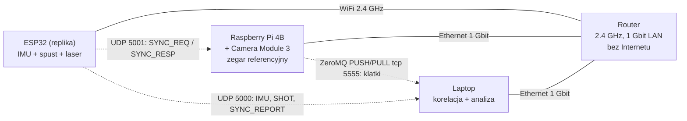
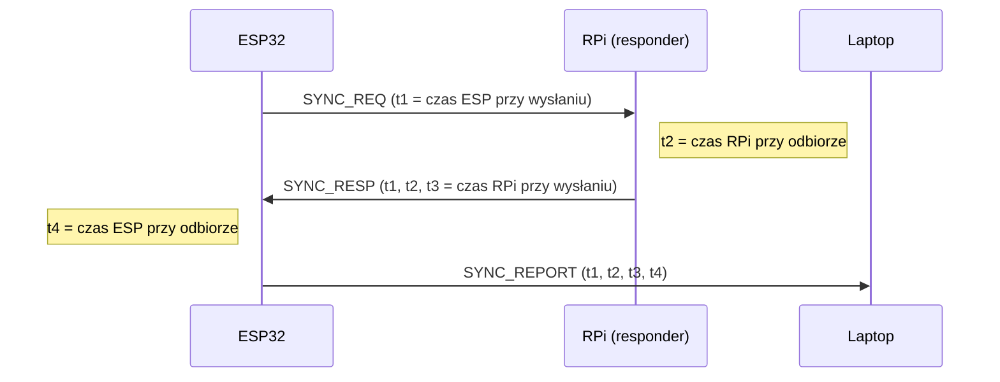

# Specyfikacja systemu — komunikacja i synchronizacja czasu

> Dotyczy zadania [#2 Przygotowanie specyfikacji](https://github.com/ZuberRS03/projekt_przejsciowy_PWR/issues/2).
> Status: **wersja robocza 0.1** (2026-10-15). Pozycje oznaczone **[DO USTALENIA]** wymagają decyzji zespołu.

## Spis treści

1. [Cel i wymagania](#1-cel-i-wymagania)
2. [Budżet błędu czasowego](#2-budżet-błędu-czasowego)
3. [Urządzenia i połączenia](#3-urządzenia-i-połączenia)
4. [Domeny zegarowe i synchronizacja](#4-domeny-zegarowe-i-synchronizacja)
5. [Protokoły komunikacji](#5-protokoły-komunikacji)
6. [Przetwarzanie na laptopie](#6-przetwarzanie-na-laptopie)
7. [Konfiguracja urządzeń](#7-konfiguracja-urządzeń)
8. [Plan testów](#8-plan-testów)
9. [Otwarte kwestie](#9-otwarte-kwestie)

---

## 1. Cel i wymagania

System treningowy z repliką broni. Replika (ESP32) mierzy ruch broni akcelerometrem i rejestruje
naciśnięcie spustu, kamera na Raspberry Pi obserwuje cel (m.in. kropkę wskaźnika laserowego),
a laptop w **czasie rzeczywistym** łączy oba strumienie. Strzał jest informacją dodatkową,
obliczaną na laptopie.

| ID | Wymaganie |
|----|-----------|
| W1 | Każda paczka danych (próbka IMU, zdarzenie spustu, klatka wideo) ma znacznik czasu nadany **u źródła**, w momencie powstania danych — nie w momencie odbioru. |
| W2 | Strzał musi zostać dopasowany do klatki wideo z dokładnością **5–10 ms** (cel: ≤ 5 ms, maksimum: 10 ms). |
| W3 | Analiza odbywa się na laptopie w czasie rzeczywistym. |
| W4 | Żadne zdarzenie spustu nie może zostać utracone; utrata pojedynczych próbek IMU lub klatek podglądu jest dopuszczalna, ale musi być wykrywalna. |
| W5 | Sieć jest wydzielona: bez Internetu i bez innych urządzeń. |

---

## 2. Budżet błędu czasowego

Wymaganie W2 dotyczy **dopasowania strzału do klatki**, a nie tylko zgodności zegarów.
Składowe błędu:

| Źródło | Wartość | Sposób ograniczenia |
|--------|---------|---------------------|
| Kwantyzacja klatek (±½ okresu klatki) | **±4,2 ms przy 120 fps** (±16,7 ms przy 30 fps) | tryb kamery 1536×864 @ 120 fps |
| Synchronizacja zegara ESP32 ↔ RPi (WiFi) | cel ≤ 1 ms | własna wymiana typu NTP z filtracją (§4.3) |
| Rolling shutter (różny czas naświetlania wierszy) | do kilku ms | korekta wg wiersza obrazu (§6.2) |
| Timestamp spustu w ISR | < 0,1 ms | `esp_timer_get_time()` w ISR (`IRAM_ATTR`) |
| Stały offset toru (definicja `SensorTimestamp`, ekspozycja) | stała | kalibracja w teście T2 (§8) |

**Wniosek:** przy 120 fps najgorszy przypadek wynosi ok. 5 ms — wymaganie jest osiągalne.
Przy 30 fps jest **nieosiągalne** niezależnie od jakości synchronizacji. Kamera musi pracować
z częstotliwością ≥ 100 fps.

---

## 3. Urządzenia i połączenia

### 3.1. Urządzenia

| Urządzenie | Sprzęt | Rola | Odpowiedzialny |
|------------|--------|------|----------------|
| Replika | ESP32, akcelerometr **[DO USTALENIA: model]**, spust, wskaźnik laserowy, bateria | źródło próbek IMU i zdarzeń spustu | ZuberRS03 (hardware), xEdziu (komunikacja) |
| Kamera | Raspberry Pi 4B 8 GB + Raspberry Pi Camera Module 3 (IMX708, 12 MPx) | źródło klatek wideo, **zegar referencyjny systemu** | xEdziu |
| Laptop | PC z gigabitowym Ethernetem | odbiór, synchronizacja, korelacja, analiza | zespół |
| Router | dowolny z pasmem **2.4 GHz** i portami **1 Gbit/s** | wydzielona sieć | — |

### 3.2. Topologia



Uzasadnienie:

- **ESP32 obsługuje wyłącznie 2.4 GHz** (802.11 b/g/n) — router WiFi 5/6 nie daje tu korzyści.
- RPi i laptop po kablu: stabilne opóźnienia i przepustowość dla nieskompresowanego wideo
  (~220 Mbit/s, §5.4) — wymaga portów **1 Gbit/s** w routerze i laptopie.

### 3.3. Adresacja

Statyczne adresy (bez DHCP — stałe IP upraszczają konfigurację i eliminują ruch DHCP):

| Urządzenie | Adres IP |
|------------|----------|
| Router | 192.168.50.1 |
| Raspberry Pi | 192.168.50.10 |
| Laptop | 192.168.50.20 |
| ESP32 | 192.168.50.30 |

### 3.4. Porty

| Port | Protokół | Kierunek | Zawartość |
|------|----------|----------|-----------|
| 5000/udp | UDP | ESP32 → laptop | IMU, SHOT, SYNC_REPORT, STATUS |
| 5001/udp | UDP | ESP32 ↔ RPi | SYNC_REQ / SYNC_RESP |
| 5555/tcp | ZeroMQ PUSH/PULL | RPi → laptop | klatki wideo z metadanymi |

---

## 4. Domeny zegarowe i synchronizacja

### 4.1. Zegary w systemie

| Domena | Zegar | Jednostka | Uwagi |
|--------|-------|-----------|-------|
| RPi (**referencyjna**) | `CLOCK_MONOTONIC` jądra Linux | ns | ten sam zegar, w którym libcamera podaje `SensorTimestamp`; nie skacze przy zmianie czasu systemowego |
| ESP32 | `esp_timer_get_time()` | µs od startu | monotoniczny, dryf kwarcu ok. ±10–20 ppm |
| Laptop | nieistotny | — | laptop tylko przelicza znaczniki; jego zegar nie musi być synchronizowany |

### 4.2. Decyzje

1. **Zegarem referencyjnym jest RPi**, nie laptop. Klatki wideo są wtedy z definicji w domenie
   referencyjnej (błąd synchronizacji wideo = 0), a RPi jako Linux zapewnia stabilne znaczniki.
   Laptop może pracować pod Windows bez dodatkowej konfiguracji czasu.
2. **ESP32 nie ustawia swojego zegara** (bez SNTP). Wszystkie dane są oznaczane surowym
   `esp_timer_get_time()`, a przeliczenie do domeny RPi wykonuje laptop.
3. **Chrony/NTP nie jest potrzebne** do korelacji danych. Może służyć wyłącznie do opisu logów
   czasem „ściennym” (opcjonalnie).

Dlaczego nie standardowe SNTP z ESP-IDF:

- domyślny interwał synchronizacji to 1 h (`CONFIG_LWIP_SNTP_UPDATE_DELAY`, minimum 15 s wg RFC 4330),
  a przy dryfie 20 ppm zegar rozjeżdża się o 1,2 ms na minutę;
- każda aktualizacja to pojedynczy pomiar bez filtracji — jitter WiFi (kilka ms) przenosi się
  wprost na błąd zegara (tryb `SNTP_SYNC_MODE_SMOOTH` jedynie rozkłada korektę w czasie);
- brak wglądu w jakość synchronizacji — a ta jest potrzebna do testów.

### 4.3. Algorytm synchronizacji

Wymiana typu NTP (4 znaczniki), wykonywana przez ESP32 co **1 s**:



Dla każdej próbki laptop wyznacza (po sprowadzeniu do wspólnej jednostki):

- czas obiegu: `RTT = (t4 − t1) − (t3 − t2)`,
- punkt ESP: `x = (t1 + t4) / 2`, punkt RPi: `y = (t2 + t3) / 2`.

Model: `t_rpi = a · t_esp + b` (`a` — dryf, `b` — offset).

1. Okno kroczące ostatnich **60 s** próbek.
2. Filtracja: tylko próbki o `RTT ≤ RTT_min(okna) + 1 ms` (opóźnienia WiFi są asymetryczne
   i mają długi ogon — próbki z małym RTT są najbliższe prawdy).
3. Regresja liniowa (najmniejsze kwadraty) na przefiltrowanych próbkach → `a`, `b`.
4. Model jest gotowy, gdy w oknie jest ≥ 10 przefiltrowanych próbek; wcześniej dane ESP są
   oznaczane jako niezsynchronizowane.
5. Restart ESP32 (skok `t_esp` do zera, wykrywany po spadku znacznika/`seq`) zeruje okno.

Ograniczenie błędu pojedynczej próbki: ±RTT/2. Rzeczywisty błąd po filtracji i regresji
weryfikuje test T1.

---

## 5. Protokoły komunikacji

### 5.1. Zasady ogólne

- Struktury binarne, **little-endian**, bez wyrównania (`__attribute__((packed))` w C,
  `struct.unpack("<…")` w Pythonie).
- Każdy pakiet UDP mieści się w jednym datagramie bez fragmentacji (≤ 1400 B).
- Każdy pakiet ma numer sekwencyjny `seq` (per nadawca, rosnący) — wykrywanie strat i duplikatów.
- Pole `version` pozwala rozwijać format; odbiornik odrzuca nieznane wersje.

### 5.2. Nagłówek wspólny (16 B)

| Offset | Pole | Typ | Opis |
|--------|------|-----|------|
| 0 | `magic` | u16 | `0x5052` („PR”) |
| 2 | `version` | u8 | `1` |
| 3 | `type` | u8 | typ wiadomości (tabela niżej) |
| 4 | `seq` | u32 | numer sekwencyjny nadawcy |
| 8 | `t_send` | i64 | czas wysłania w domenie nadawcy (ESP: µs, RPi: ns) |

| `type` | Nazwa | Nadawca → odbiorca |
|--------|-------|--------------------|
| 1 | `IMU` | ESP32 → laptop |
| 2 | `SHOT` | ESP32 → laptop |
| 3 | `SYNC_REQ` | ESP32 → RPi |
| 4 | `SYNC_RESP` | RPi → ESP32 |
| 5 | `SYNC_REPORT` | ESP32 → laptop |
| 6 | `STATUS` | ESP32 → laptop |
| 16 | `VIDEO_FRAME` | RPi → laptop (ZeroMQ) |

### 5.3. Wiadomości ESP32

**`IMU`** — paczka próbek akcelerometru. Wysyłana co N próbek (domyślnie 5 próbek przy 100 Hz
→ 20 pakietów/s); opóźnienie paczkowania nie wpływa na dokładność, bo każda próbka ma własny znacznik.

| Pole | Typ | Opis |
|------|-----|------|
| `count` | u8 | liczba próbek (1–64) |
| `range` | u8 | kod zakresu pomiarowego czujnika (przelicznik na g) |
| `reserved` | u16 | 0 |
| `samples[count]` | — | po 14 B: `t_us` (i64), `ax`, `ay`, `az` (i16, surowe) |

**`SHOT`** — zdarzenie spustu.

| Pole | Typ | Opis |
|------|-----|------|
| `shot_id` | u32 | rosnący identyfikator strzału |
| `t_shot_us` | i64 | czas pierwszego zbocza spustu (z ISR) |
| `repeat` | u8 | numer powtórzenia (0, 1, 2) |
| `reserved` | u8[3] | 0 |

Każdy strzał jest wysyłany **3 razy** (natychmiast, +5 ms, +10 ms). Laptop usuwa duplikaty po
`shot_id`. Spełnia to W4 bez potwierdzeń (ACK) i retransmisji.

**`SYNC_REQ`** — sam nagłówek; `t_send` = t1.

**`SYNC_REPORT`**

| Pole | Typ | Opis |
|------|-----|------|
| `t1_us` | i64 | ESP: wysłanie SYNC_REQ |
| `t2_ns` | i64 | RPi: odbiór SYNC_REQ |
| `t3_ns` | i64 | RPi: wysłanie SYNC_RESP |
| `t4_us` | i64 | ESP: odbiór SYNC_RESP |

**`STATUS`** (co 1 s) — `battery_mv` (u16), `rssi_dbm` (i8), `flags` (u8), `imu_overruns` (u32).

### 5.4. Wiadomości RPi

**`SYNC_RESP`** (UDP 5001) — nagłówek RPi (`t_send` = t3, w ns) + `t1_us` (i64, echo z żądania)
+ `t2_ns` (i64). `seq` jest kopiowany z żądania, aby ESP mógł sparować odpowiedź.

Responder znakuje `t2` natychmiast po odbiorze, a `t3` tuż przed wysłaniem, zegarem
`time.clock_gettime_ns(time.CLOCK_MONOTONIC)`.

**`VIDEO_FRAME`** (ZeroMQ PUSH/PULL, tcp 5555) — wiadomość dwuczęściowa (multipart):

- część 1: nagłówek wspólny + metadane,
- część 2: surowe bajty obrazu (wysyłane z `copy=False`).

| Pole metadanych | Typ | Opis |
|-----------------|-----|------|
| `frame_seq` | u32 | numer klatki z kamery |
| `t_sensor_ns` | i64 | `SensorTimestamp` z metadanych libcamera |
| `exposure_us` | u32 | `ExposureTime` |
| `frame_duration_us` | u32 | rzeczywisty okres klatki |
| `line_time_ns` | u32 | czas odczytu jednego wiersza sensora (do korekty rolling shutter) |
| `width`, `height` | u16, u16 | wymiary obrazu |
| `sensor_rows` | u16 | liczba wierszy trybu sensora (864) — do przeliczenia wiersza obrazu na wiersz sensora |
| `format` | u8 | `1` = Y8 (skala szarości) |

Strumień: `lores` **640×360, Y8, bez kompresji** → ok. 230 KB/klatkę, ~220 Mbit/s przy 120 fps.

- Bez kompresji: zero opóźnienia enkodera, brak artefaktów zacierających kropkę lasera.
  Sprzętowy enkoder H.264 RPi 4 nie obsługuje 1536×864 @ 120 fps.
- **PUSH/PULL zamiast PUB/SUB:** PUB/SUB po cichu gubi wiadomości po przekroczeniu bufora
  (high-water mark) i tuż po dołączeniu subskrybenta („slow joiner”). W PUSH/PULL nadawca
  się blokuje — dlatego wysyłka odbywa się w osobnym wątku z krótką kolejką; przy jej
  przepełnieniu najstarsza klatka jest odrzucana, a strata widoczna jest po `frame_seq`.

**[DO USTALENIA]** czy Python na RPi 4 utrzyma 120 fps z wysyłką (test T4). Plan B: niższa
rozdzielczość `lores` albo detekcja kropki na RPi i wysyłanie jej współrzędnych + podglądu
w niższym fps.

---

## 6. Przetwarzanie na laptopie

### 6.1. Odbiór

- Wątek/zadanie UDP (port 5000): dekodowanie, deduplikacja `SHOT`, zasilanie modelu
  synchronizacji (`SYNC_REPORT`), statystyki strat po `seq`.
- Wątek ZeroMQ PULL (port 5555): odbiór klatek, statystyki strat po `frame_seq`.
- Wszystkie znaczniki ESP są przeliczane do domeny RPi modelem z §4.3.

### 6.2. Czas klatki i korekta rolling shutter

Dla wiersza obrazu `y` (np. wiersza, w którym wykryto kropkę lasera):

```
y_sensor  = y · sensor_rows / height
t_row(y)  = t_sensor_ns + y_sensor · line_time_ns + exposure_us · 1000 / 2 + C
```

`C` — stała kalibracyjna toru wyznaczona w teście T2 (obejmuje m.in. dokładną definicję
`SensorTimestamp` w libcamera). Gdy pozycja kropki nie jest znana, przyjmuje się środek obrazu.

### 6.3. Dopasowanie strzału do klatki

1. Strzał o czasie `T = a · t_shot_us + b` trafia do kolejki oczekujących.
2. **Watermark:** strzał jest rozstrzygany, gdy odebrano już klatkę o
   `t_sensor_ns > T + frame_duration`. Opóźnienie decyzji wynika z faktycznego napływu danych,
   a nie ze stałego bufora.
3. Wybierana jest klatka `k` minimalizująca `|t_row_k(y) − T|`; wynik zawiera tę różnicę
   (miara pewności dopasowania).
4. Jeśli model synchronizacji nie jest gotowy (§4.3 pkt 4), strzał jest oznaczany jako
   niepewny.

---

## 7. Konfiguracja urządzeń

### 7.1. Router

- Brak połączenia WAN/Internetu, DHCP wyłączony lub z rezerwacjami adresów z §3.3.
- WiFi tylko 2.4 GHz, stały kanał (najmniej zajęty z 1/6/11), szerokość 20 MHz,
  WPA2-PSK, band steering wyłączony.

### 7.2. Raspberry Pi 4B

- **System:** aktualny Raspberry Pi OS Lite 64-bit.
- **Kamera:** `python3-picamera2` z apt (nie z pip). Weryfikacja: `rpicam-hello --list-cameras`.
- **Sieć:** statyczne IP na `eth0` (NetworkManager, `nmcli`).
- **`/boot/firmware/config.txt`:** `dtoverlay=disable-wifi` i `dtoverlay=disable-bt` — radio RPi
  nie jest używane i nie powinno zakłócać pasma 2.4 GHz.
- **Wydajność:** governor CPU `performance`; radiator/wentylator (120 fps + wysyłka obciążają CPU);
  kontrola `vcgencmd get_throttled` (oczekiwane `0x0`).
- **Usługi systemd:** responder synchronizacji (UDP 5001) i nadajnik wideo (ZeroMQ 5555),
  uruchamiane automatycznie; dostęp przez SSH.
- **Kamera — konfiguracja w Picamera2:** tryb sensora 1536×864, `FrameDurationLimits`
  = (8333, 8333) µs (120 fps), **stała ekspozycja i wzmocnienie** (bez AE — stały timing
  i lepsza widoczność kropki lasera), strumień `lores` 640×360.

### 7.3. ESP32 (ESP-IDF)

- `esp_wifi_set_ps(WIFI_PS_NONE)` — domyślny tryb `WIFI_PS_MIN_MODEM` usypia radio i zwiększa opóźnienia.
- **Bluetooth wyłączony** — przy koegzystencji WiFi/BT radio WiFi usypia się poza swoim
  oknem czasowym nawet przy `WIFI_PS_NONE`.
- Statyczne IP, automatyczne ponowne łączenie z WiFi.
- **Spust:** przerwanie GPIO (`IRAM_ATTR`); w ISR wyłącznie `esp_timer_get_time()` i wrzucenie
  zdarzenia do kolejki FreeRTOS. Debouncing programowy z zachowaniem czasu **pierwszego** zbocza
  (kolejne zbocza w oknie ~20 ms są ignorowane).
- **Akcelerometr:** odczyt wyzwalany sygnałem data-ready (lub FIFO) czujnika, znacznik czasu
  z przerwania data-ready.
- **Zadania:** osobne zadania dla IMU, spustu i sieci, z priorytetami standardowymi —
  dokładność zapewnia znacznik w ISR, a nie priorytet zadania (podnoszenie priorytetów ponad
  stos WiFi może destabilizować łączność).

---

## 8. Plan testów

Każdy test zapisuje surowe logi (wszystkie znaczniki czasu), aby wyniki można było przeliczyć ponownie.

| ID | Test | Przebieg | Kryterium zaliczenia |
|----|------|----------|----------------------|
| T1 | **Synchronizacja zegarów (kabel GPIO)** | GPIO ESP32 połączony z GPIO RPi (wspólna masa). ESP co 100 ms generuje impuls i zapisuje swój czas; RPi znakuje zbocze (`CLOCK_MONOTONIC`). Błąd = czas RPi − przeliczony czas ESP. Sesja 30 min. | p95 \|błąd\| ≤ 1 ms, p99 ≤ 2 ms |
| T2 | **Dopasowanie strzału do klatki (laser)** | Spust włącza laser skierowany w pole widzenia kamery. Prawdziwa klatka = pierwsza klatka z widoczną kropką. Porównanie z klatką wskazaną przez algorytm §6.3. ≥ 100 strzałów. Wyznaczenie stałej `C`. | ≥ 95% strzałów w poprawnej klatce; \|Δt\| ≤ 5 ms (p95), ≤ 10 ms (max) |
| T3 | **Sieć** | Pomiar RTT, jitteru i strat UDP (ESP) oraz strat klatek (RPi → laptop) przy odległości 1 m / 5 m / 10 m i ruchu repliki. | straty UDP < 1%; 0 utraconych strzałów; straty klatek < 0,5% |
| T4 | **Wydajność RPi** | 10 min pracy z 120 fps i wysyłką; pomiar rzeczywistego fps, obciążenia CPU, temperatury, `get_throttled`. | fps 120 ±1%; brak throttlingu |
| T5 | **Długa sesja i odporność** | 60 min pracy; w trakcie restart ESP32 i chwilowe zerwanie WiFi. | T1 spełnione przez całą sesję; resynchronizacja ≤ 15 s po restarcie |

---

## 9. Otwarte kwestie

| # | Kwestia | Wpływ |
|---|---------|-------|
| 1 | Model akcelerometru (zakres, ODR, czy ma data-ready/FIFO) | format `IMU`, sposób próbkowania |
| 2 | Czy laptop ma gigabitowy Ethernet (ew. adapter USB 3.0 → 1 Gbit) | wymagane dla strumienia z §5.4 |
| 3 | Gdzie wykrywać kropkę lasera: laptop (pełny strumień) czy RPi | obciążenie sieci i RPi |
| 4 | Czy Python na RPi utrzyma 120 fps z wysyłką (test T4) | ewentualny plan B z §5.4 |
| 5 | Schemat elektryczny ESP32 (zapowiedziany w #2) | rozdział 3 — piny spustu, lasera, IMU |
| 6 | Język implementacji laptopa (Python?) | — |
